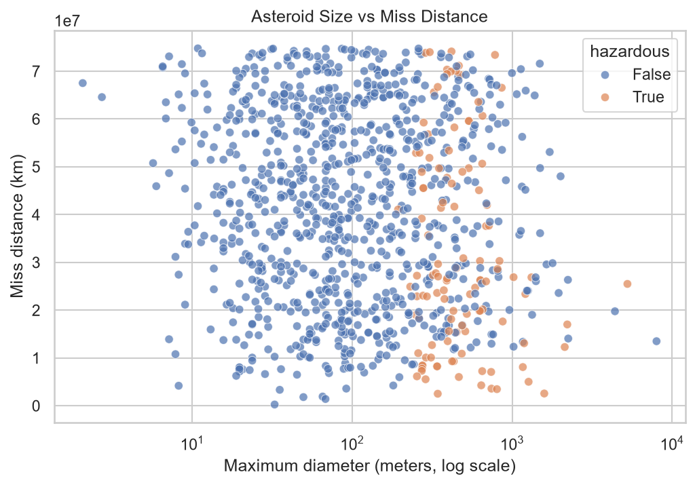

# Asteroid Hazard Tracker

A beginner-friendly machine learning project that collects real asteroid data from NASA, explores it with charts, and trains a model to flag **potentially hazardous asteroids**. It includes a small Streamlit dashboard where you can type in an asteroid's facts and get a first guess.

> This is a learning project. NASA's official label comes from detailed orbit calculations and remains the real authority.

## What it does
1. **Collects** about 30 weeks of near-Earth asteroid data from NASA's NeoWs API (about 1,000 asteroids).
2. **Cleans and explores** the data with Pandas, Matplotlib and Seaborn.
3. **Trains** a Random Forest model on size, speed and miss distance.
4. **Evaluates** it with a confusion matrix, recall and precision.
5. **Serves** the model in a Streamlit dashboard.

## What I found
- Only about 12% of asteroids are labelled hazardous, so the data is imbalanced.
- **Size** was the strongest clue. Hazardous asteroids are mostly bigger, and speed helped a little.
- On the test set (decision cutoff 0.5): **recall 0.91** (21 of 23 hazardous asteroids found), **precision 0.44**, **accuracy 0.86**.



## Limitations
- The model only sees four facts (size, speed, one day's miss distance). NASA's label uses the full orbit.
- Recall is high, but precision is low, so many flagged asteroids are false alarms.
- The test set has only 23 hazardous asteroids, so the scores are rough.
- It is a screening demo, not a safety tool.

## Project structure
```
data/      asteroids.csv (data downloaded from NASA)
charts/    saved charts
models/    trained model
src/       fetch_data.py, check_data.py, make_charts.py, train_model.py, app.py
```

## How to run it
1. Install the libraries:
   ```
   pip install -r requirements.txt
   ```
2. Get a free API key at https://api.nasa.gov
3. Copy `src/config_example.py` to `src/config.py` and paste your key into it.
4. Run the steps in order:
   ```
   python src/fetch_data.py
   python src/make_charts.py
   python src/train_model.py
   streamlit run src/app.py
   ```

## Tools used
Python, Pandas, Matplotlib, Seaborn, scikit-learn, Streamlit, NASA NeoWs API.

## Author
Built by Haleema (HaleemaKhan005), an AI student.